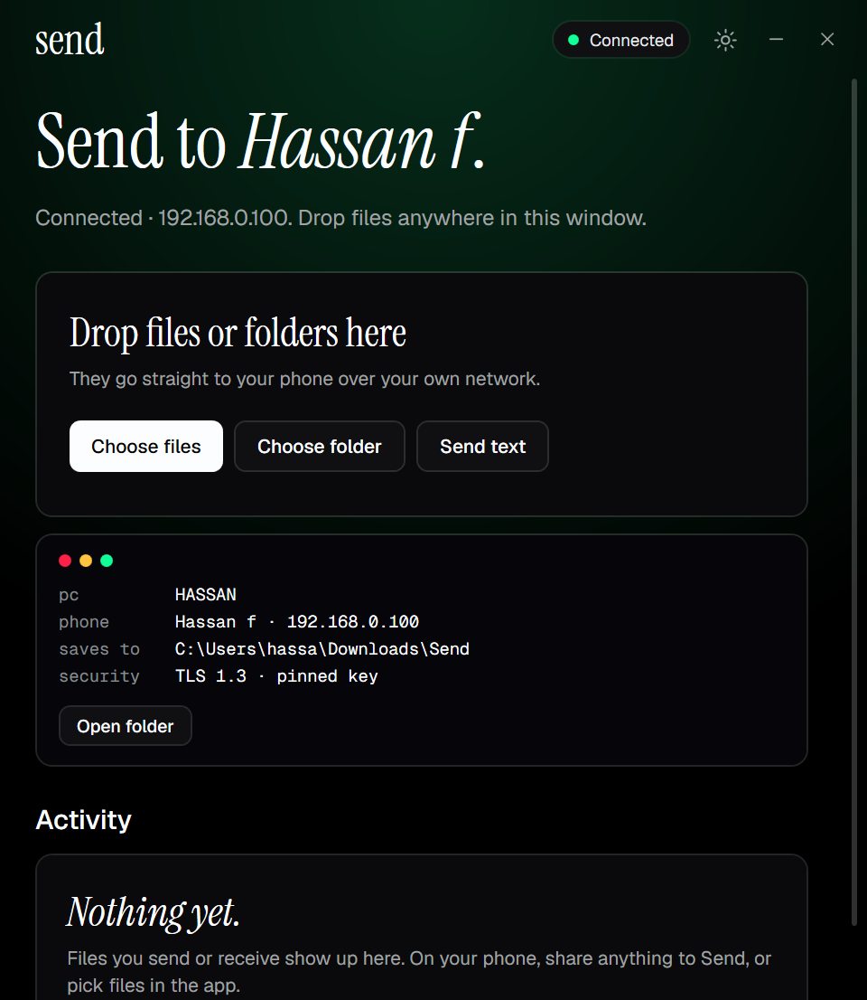
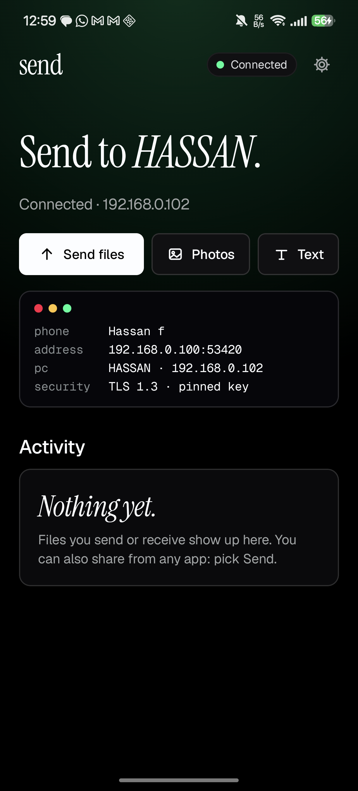
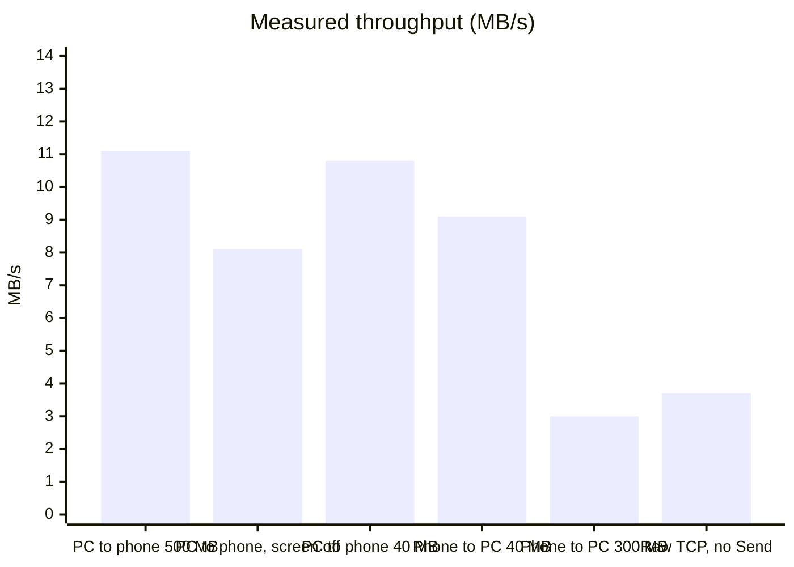
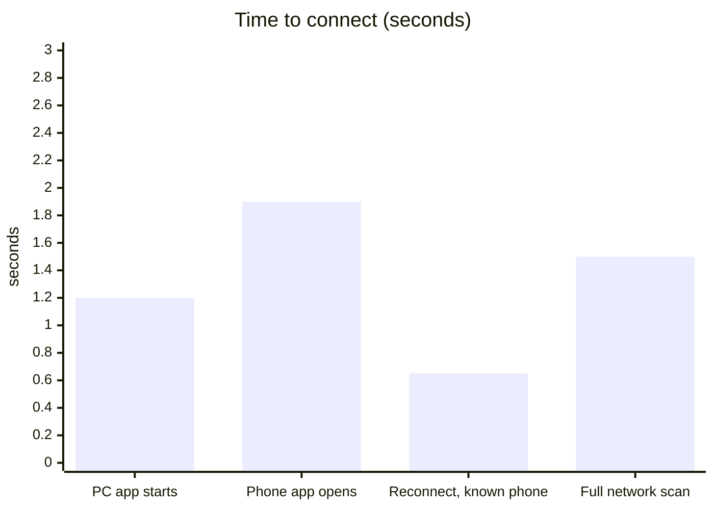
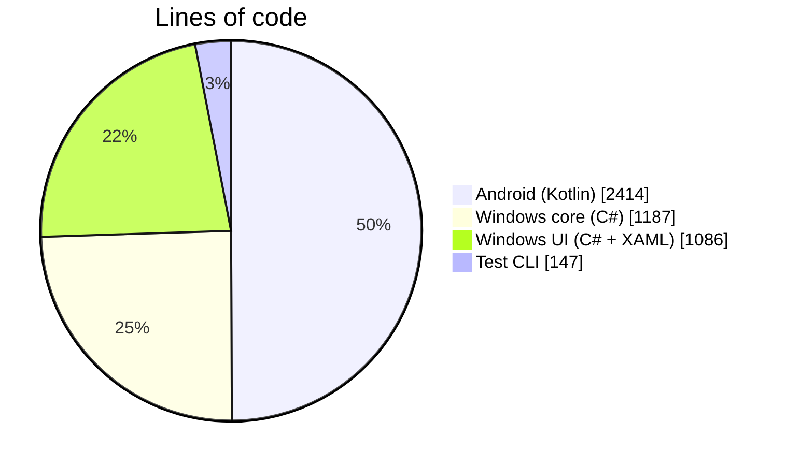
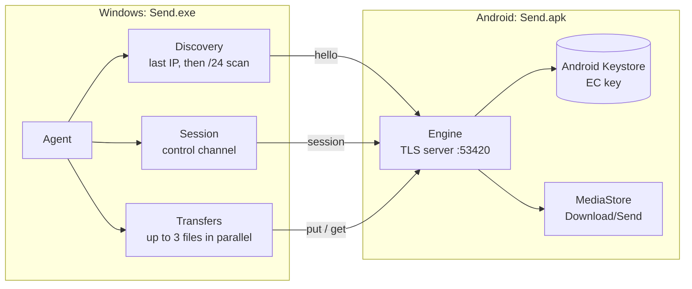
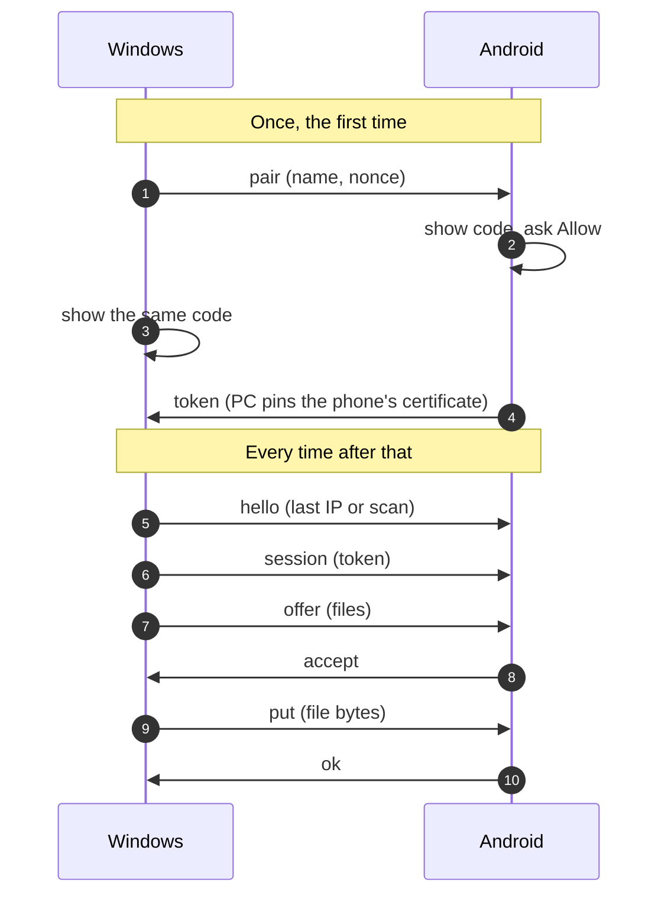

<div align="center">


# Send

**Send files between Windows and Android over your own Wi-Fi.**<br>
No cloud. No account. No cable. Open the app on both devices and they connect by themselves.

[](https://github.com/Hasan580/Send/releases/latest)
[](https://github.com/Hasan580/Send/actions/workflows/build.yml)
[](LICENSE)
[](https://github.com/Hasan580/Send/releases)
[](https://github.com/Hasan580/Send/stargazers)


[Download](#download) · [Features](#features) · [By the numbers](#by-the-numbers) · [How it works](#how-it-works) · [Security](#security) · [Build](#build-from-source) · [Changelog](CHANGELOG.md)

<br>

&nbsp;&nbsp;

</div>

<br>

## Why Send

Most "send to PC" tools want an account, a cable, or a trip through someone else's server. Send is just two small apps
that talk directly to each other on your network:

- Open Send on the phone and on the PC. They find each other and connect in about two seconds.
- Drop files on the PC window, or tap **Send files** / **Photos** on the phone, or share from any app. Done.
- Everything is encrypted, nothing leaves your network, and there is nothing to sign up for.

## Download

Grab the latest build from the **[Releases page](https://github.com/Hasan580/Send/releases/latest)**.

| Platform | File | Needs |
|---|---|---|
| Windows | `Send-<version>-win-x64.exe` (0.7 MB, single file) | Windows 10 (1607+) or 11 and the [.NET 10 Desktop Runtime](https://dotnet.microsoft.com/download/dotnet/10.0) |
| Android | `Send-<version>.apk` (2.4 MB) | Android 10 or newer |

Each release lists SHA-256 checksums (`SHA256SUMS.txt`). The Windows build is not code-signed yet, so SmartScreen may ask
you to confirm ("More info" then "Run anyway"). Android asks you to allow installing from your browser or file manager the first time.

## Features

| | |
|---|---|
| **Automatic** | No IP addresses, no QR codes. The PC keeps looking for the phone and joins the moment the phone app opens (about 2 s). |
| **Pair once** | First time only: the PC shows a 4-digit code, the phone shows the same one, you tap Allow. After that it reconnects on its own. |
| **Both directions** | PC to phone and phone to PC. Files, whole folders (structure kept) and text snippets. |
| **Photos built in** | A gallery inside the Android app: browse your photos and videos, select many, send. Or use the system picker. |
| **Share sheet** | Share from Gallery, Files, Chrome or any app and choose Send. |
| **Encrypted** | TLS 1.3 with the phone's certificate pinned by the PC. A wrong token or certificate is refused. |
| **Fast** | One streaming connection per file with 1 MB buffers, up to 3 files in parallel. It saturates your Wi-Fi. |
| **Screen off is fine** | The phone side is a foreground service holding a Wi-Fi lock while it transfers. |
| **Small** | 0.7 MB Windows exe, 2.4 MB APK, no web view, no bundled runtime on the phone. |
| **No firewall fuss** | The PC only ever connects *out*, so Windows Firewall (even on a Public network) never needs a rule. |
| **Windows niceties** | Drag and drop, tray icon, optional start with Windows, "Show in folder", single instance. |

Received files land in `Downloads\Send` on the PC and `Download/Send` on the phone (no storage permission needed).

## Quick start

1. Install `Send.apk` on the phone and run `Send.exe` on the PC, both on the same network.
2. First time only: check that the code on the PC matches the phone, then tap **Allow** on the phone.
3. Drop files on the PC window, or use **Send files**, **Photos** or **Text** on the phone.

> **If the PC keeps saying "Searching":** make sure both devices are on the same Wi-Fi or LAN, there is no VPN running on the phone,
> and the router does not isolate wireless clients ("AP isolation"). You can also type the phone's address into Settings
> on the PC (the phone shows it on its home screen).

## By the numbers

Measured on a real setup: Windows 11 PC on gigabit Ethernet, Honor 200 Pro on a **2.4 GHz 802.11n** router (link speed 162 to 300 Mbps).



The 2.4 GHz link tops out around 11 MB/s, and Send reaches it. The two low bars are the phone's *uplink* stalling in bursts on this
router: plain TCP with no Send code at all (`nc` on the phone) averaged 3.7 MB/s over the same path, so that is the radio, not the app.
On a 5 GHz network expect far more. Every transfer in these tests was verified by SHA-256 on the receiving side
(a 500 MB file, a 200-file nested folder with Unicode names and an empty file, and phone to PC through the real Android share intent).





## How it works

The phone is the only server (TLS on port `53420`). The PC discovers it by trying the phone's last known address first, then
probing the local `/24` of its physical network adapter, and only ever opens connections *to* the phone.





| Connection | Purpose |
|---|---|
| `hello` | Who are you? (name, id). Used by discovery. |
| `pair` | One-time pairing. The phone shows a code derived from its certificate and the PC shows the same code. A match means nobody is in the middle. The phone then hands out a random token. |
| `session` | A long-lived control channel (offers, accept, cancel, text, keep-alive), authenticated by the token. |
| `put` / `get` | Data connections the PC opens on demand for file bytes. |

Wire format: a 4-byte length, a JSON frame, then raw file bytes where needed. The protocol is called **SEND/1**; see
[`Wire.cs`](windows/Send.Core/Wire.cs) and [`net/`](android/app/src/main/java/com/hassanazawi/send/net/).

## Security

| Threat | What stops it |
|---|---|
| Someone on the Wi-Fi reads your files | Everything is TLS 1.3. |
| Someone pretends to be your phone | The PC pins the phone's certificate at pairing and refuses any other one. |
| Someone pretends to be your PC | Every request needs the random 256-bit token handed out at pairing, compared in constant time. |
| A stranger pairs with your phone | Pairing needs you to tap **Allow** after matching a code that is derived from the certificate. |
| Path tricks in file names | Names and folders are sanitised on both sides (no `..`, drive letters or illegal characters). |
| Oversized or malformed frames | Frames are capped (8 MB) and rejected otherwise. |

The phone's private key lives in the Android Keystore and never leaves the device. The repo contains a `probe` command
(`sendcli probe <phone-ip>`) that checks the refusals above against a real phone. See [SECURITY.md](SECURITY.md) for reporting issues.

## Versions

| | |
|---|---|
| **Send** | `1.0.0` (see the [changelog](CHANGELOG.md)) |
| **Protocol** | `SEND/1` (apps of the same major version interoperate; a breaking wire change bumps both) |
| **Android** | minSdk 29 (Android 10), targetSdk 36, Kotlin 2.2.20, AGP 8.13.0, Compose BOM 2025.12.01 |
| **Windows** | .NET 10 (WPF), Windows 10 1607+ / Windows 11 |
| **TLS** | 1.3 (1.2 accepted), ECDSA P-256 |

Releases follow [Semantic Versioning](https://semver.org). Every release on the Releases page ships both apps and a `SHA256SUMS.txt`.

## Build from source

**Windows** (needs the .NET 10 SDK):

```
dotnet publish windows/Send/Send.csproj -c Release -r win-x64 --self-contained false -p:PublishSingleFile=true -o dist/windows
```

**Android** (needs JDK 17+ and the Android SDK with platform 36):

```
cd android
./gradlew assembleDebug        # works without any signing key
```

For a signed release build, create a keystore and an `android/keystore.properties` (both are git-ignored):

```
keytool -genkeypair -keystore send.jks -alias send -keyalg RSA -keysize 2048 -validity 10000
# android/keystore.properties
#   storeFile=../send.jks
#   storePassword=...
#   keyAlias=send
#   keyPassword=...
./gradlew assembleRelease
```

Create `android/local.properties` with `sdk.dir=<path to your Android SDK>` if Gradle cannot find the SDK. Keep your keystore
backed up: Android only installs updates signed with the same key.

### Test tool

`windows/Send.Cli` drives the same engine the app uses, which makes scripted tests easy:

```
dotnet run --project windows/Send.Cli -- scan
dotnet run --project windows/Send.Cli -- send <file-or-folder>...
dotnet run --project windows/Send.Cli -- listen 60
dotnet run --project windows/Send.Cli -- probe <phone-ip>
```

Set `SEND_HOME` to give it its own config folder so it does not share the app's pairing.

### Project layout

```
android/        Kotlin + Jetpack Compose app (no Material library, own components)
windows/
  Send/         WPF app: UI, tray, single instance
  Send.Core/    protocol, discovery, pairing, transfer engine
  Send.Cli/     test driver
tools/          font and icon generators
licenses/       licenses of the bundled fonts
docs/           screenshots
```

## FAQ

**Does it use the internet?** No. Both devices talk directly over your local network. Nothing is uploaded anywhere.

**Why does the phone act as the server?** So the PC never needs an inbound firewall rule. Windows blocks incoming connections on "Public" networks;
outgoing ones are always allowed, so the PC just connects out.

**Why is phone to PC sometimes slower?** On busy 2.4 GHz Wi-Fi the phone's upload stalls in bursts (see the numbers above). Put the phone on 5 GHz if your router has it.

**How do I unpair?** Settings on either device, then **Forget**. The next time both apps are open they pair again.

**Where do received files go?** `Downloads\Send` on the PC (changeable in Settings) and `Download/Send` on the phone.

**Why does Windows warn about the exe?** It is not code-signed yet (certificates cost money). The checksum on the release page lets you verify the download.

## Roadmap

- [ ] Resume interrupted transfers
- [ ] QR-code pairing as a shortcut
- [ ] More than one phone at a time
- [ ] Self-contained Windows build and installer
- [ ] Code-signed Windows build
- [ ] Clipboard sync
- [ ] Send folders from the phone

## Contributing

Issues and pull requests are welcome, see [CONTRIBUTING.md](CONTRIBUTING.md). Please report security problems privately, see [SECURITY.md](SECURITY.md).

## License

[MIT](LICENSE). The bundled fonts (Instrument Serif, Geist, Geist Mono) are under the SIL Open Font License, see [licenses](licenses/README.md).

The interface follows a dark, editorial design spec: a pure black canvas, a serif display headline with italic accents, hairline borders instead of
shadows, one white primary button, and a single soft glow whose colour shows the state (blue searching, green connected, orange transferring).
